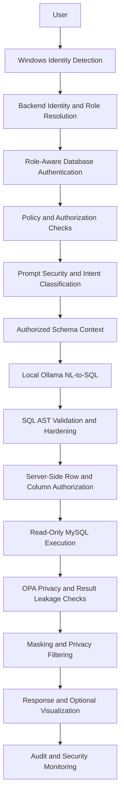

::: {align="center"}

# 🛡️ QueryShield

### A Defense-in-Depth Framework for Secure Natural Language-to-SQL Enterprise Data Access

**Ask questions in plain English. Query authorized data. Keep the LLM
outside the security boundary.**

```{=html}
<p>
```

``{=html}
``{=html}
``{=html}
``{=html}
``{=html}

```{=html}
</p>
```

*An offline-first, on-premise NL2SQL project focused on identity-aware
access, SQL authorization, and privacy-aware results.*
:::

---

## 📌 Overview

Enterprise databases contain sensitive information, but accessing that
information often requires SQL knowledge or broad database permissions.
Natural Language-to-SQL (NL2SQL) makes data easier to query---but
executing model-generated SQL directly can expose confidential data,
produce unsafe queries, or bypass intended access boundaries.

**QueryShield** is designed to place a deterministic security gateway
between natural-language requests and enterprise data. It uses a locally
hosted language model through **Ollama** to generate candidate SQL,
while backend policy checks and database privileges---not the
model---determine what a user is allowed to access.

The project targets offline/on-premise environments where sensitive
employee data should remain within the organization's infrastructure
during normal application operation.

## 🎯 Core Principles

- **Identity before data access:** resolve the user's identity and
  role before establishing authorized database access.
- **The LLM is not the security authority:** model output is treated
  as untrusted input.
- **Defense in depth:** combine application authorization, SQL
  parsing, database privileges, and post-query privacy controls.
- **Least privilege:** use role-aware database connections and
  read-only access for query execution.
- **Privacy after execution:** validate not only the query but also
  the data returned to the user.
- **Local-first inference:** use Ollama for local model inference
  rather than depending on a hosted LLM API at runtime.

## ✨ Key Capabilities

### 🔐 Identity & Role-Aware Database Access

- Windows username detection and backend identity-to-employee mapping.
- Admin/Employee role resolution and role-consistency checks.
- Database connectivity established after identity and role
  validation.
- Role-aware MySQL connection management with separate database
  accounts.
- Server-side authorization; client-supplied role or employee
  identifiers must not be treated as authoritative.

> **Deployment note:** local Windows username detection is not, by
> itself, equivalent to verified enterprise Windows/Active Directory
> authentication. Validate the identity integration in the intended
> deployment environment before relying on it in production.

### 🤖 Natural Language-to-SQL

- Natural-language employee-data questions.
- Intent classification before SQL generation.
- Authorized schema context for the local model.
- Ollama-based candidate SQL generation.
- Controlled conversational follow-up support.

### 🛡️ SQL Security Gateway

- SQL parsing and AST-based validation using SQLGlot.
- SELECT-only query enforcement.
- Multiple-statement rejection.
- Unauthorized table and column detection.
- Row-level authorization checks.
- Protection against unauthorized joins, subqueries, and query-scope
  expansion.
- Query hardening, including result limits and complexity controls
  where configured.
- Database execution blocked when authorization fails.

### 🔒 Privacy & Leakage Protection

- Policy evaluation using Open Policy Agent (OPA).
- Sensitive-field masking or removal.
- Small-group aggregation privacy controls.
- Post-query result inspection and leakage scanning.
- Presidio integration for detecting sensitive information.
- Visualization based on the authorized, privacy-processed result
  rather than raw database output.

### 📊 Analytics & Visualization

- Aggregation, grouping, filtering, sorting, comparisons, and
  date-oriented analysis.
- Result visualization options including KPI, bar, line, pie,
  histogram, and table formats.
- Visualization selection based on the processed query result.

### 🧾 Auditing & Operations

- Audit and security-event infrastructure.
- Health and alerting components are part of the ongoing
  implementation.
- Automated tests for core security and query-processing behavior.

*Feature descriptions reflect project implementation notes; confirm the
current repository and deployment configuration before treating every
capability as production-ready.*

---

## 🏗️ Architecture



### End-to-End Query Flow

1. **Identify the user** and resolve the employee mapping and role on
   the backend.
2. **Authenticate database access** using the connection and privileges
   appropriate to the verified user type.
3. **Evaluate policies** for the requested data, role, employee scope,
   and sensitivity.
4. **Inspect the request** for suspicious instructions and classify its
   intent.
5. **Construct authorized schema context** and send the request to the
   locally hosted Ollama model.
6. **Generate candidate SQL** without allowing the model to make
   authorization decisions.
7. **Parse and validate SQL**; reject non-SELECT statements, multiple
   statements, and unauthorized references.
8. **Enforce row/column policies** independently of model instructions.
9. **Execute through least-privilege database access** with appropriate
   query limits and timeouts.
10. **Inspect and protect results** through privacy and leakage controls
    before returning the response.
11. **Record security-relevant events** for audit and monitoring.

---

## 🧰 Technology Stack

  Layer                        Technologies

---

  Frontend                     React
  Backend API                  Python, FastAPI
  Relational database          MySQL
  Database access              SQLAlchemy, PyMySQL
  Local LLM runtime            Ollama
  SQL parsing and AST checks   SQLGlot
  Policy engine                Open Policy Agent (OPA), Rego
  Sensitive-data detection     Microsoft Presidio
  Testing                      Pytest
  Deployment approach          Offline / on-premise / internal network target

---

## 🗂️ Repository Structure

The exact directory layout may vary as the project evolves. A typical
layout is:

```text
QueryShield/
├── frontend/             # React user interface
├── backend/
│   ├── app/               # FastAPI application and services
│   ├── tests/             # Automated tests
│   └── requirements.txt
├── database/              # Schema and safe sample data, if included
├── docs/                  # SRS, architecture, and project documentation
├── .env.example           # Placeholder configuration only
├── .gitignore
└── README.md
```

Keep real credentials, production data, local model files, virtual
environments, and generated build artifacts out of version control.

---

## ⚙️ Getting Started

> The commands below are a general setup template. Adjust file paths,
> environment variable names, database scripts, and model names to match
> the actual repository.

### Prerequisites

- Python 3.10+ (use the version supported by the project's dependency
  files).
- Node.js and npm for the React frontend.
- MySQL Server.
- Ollama installed locally.
- A compatible Ollama model downloaded on the machine that runs
  inference.
- Git.

### 1. Clone the repository

```bash
git clone https://github.com/Shreya-1831/QueryShield.git
cd QueryShield
```


### 2. Configure the backend

```bash
cd backend
python -m venv .venv
```

Activate the environment:

**Windows PowerShell**

```powershell
.\.venv\Scripts\Activate.ps1
```

**macOS / Linux**

```bash
source .venv/bin/activate
```

Install dependencies if `requirements.txt` is present:

```bash
python -m pip install --upgrade pip
pip install -r requirements.txt
```

Create a local `.env` file using the project's `.env.example` as a
guide. Supply local configuration values without committing secrets.

### 3. Configure MySQL

1. Start MySQL and create the development database using the project's
   schema.
2. Configure the role-specific database accounts required by the
   application.
3. Grant only the privileges each account needs; query execution should
   use least-privilege, read-only access.
4. Configure the backend's database settings locally.
5. Use synthetic or anonymized records for development and demos.

**Do not use production employee records or commit database passwords,
dumps, or real personal information.** Verify the effective MySQL
privileges for each account before testing.

### 4. Start Ollama

Start the Ollama service and download the model selected by your
configuration. For example:

```bash
ollama pull <your-configured-model>
```

Then verify that the model is available locally:

```bash
ollama list
```

Use the model name configured by QueryShield; the placeholder above is
not a required model name.

### 5. Run the backend

From the backend directory, use the application's actual FastAPI entry
point. If it is `app.main:app`, the command is:

```bash
uvicorn app.main:app --reload
```

The `--reload` option is intended for local development, not production
deployment.

### 6. Run the frontend

If the frontend has its own `package.json`:

```bash
cd ../frontend
npm install
npm run dev
```

Use the scripts defined in the repository's `package.json`. Configure
the frontend API base URL to point to the local FastAPI service.

### 7. Run tests

From the backend directory, activate the project's virtual environment
and run:

```bash
pytest
```

For a meaningful verification, confirm the actual test output in your
environment and test the database-backed authorization paths---not only
mocked unit tests.

---

## 🔑 Security Model

QueryShield is designed around the idea that **valid SQL is not
necessarily authorized SQL**.

---

  Control                             Purpose

---

  Backend identity resolution         Establishes the identity and role
                                      used for authorization

  Role-aware DB connection            Selects database access based on
                                      the resolved user type

  Prompt inspection                   Detects suspicious or unsupported
                                      requests before generation

  Authorized schema context           Limits schema information supplied
                                      to the model

  AST-based SQL validation            Inspects query structure rather
                                      than relying only on string
                                      matching

  Row and column authorization        Enforces data scope independently
                                      of model output

  Read-only DB privileges             Provides an independent
                                      database-level restriction

  Query limits and timeouts           Reduce excessive or expensive query
                                      execution

  Post-query privacy checks           Detects or removes data that should
                                      not be disclosed

Audit and security events           Supports investigation and
                                      operational monitoring
------------------------------------------------------------

### Security Disclaimer

QueryShield is a project implementation, not a certification or
guarantee of security. Local inference can reduce dependence on external
AI services, but it does not automatically make the entire application
secure or offline. Network access, telemetry, package installation,
identity integration, database configuration, logging, and deployment
controls must be reviewed separately.

Before production use, verify real Windows/AD authentication, session
handling, database grants, policy coverage, prompt-injection behavior,
query limits, result-leakage handling, and deployment isolation.

---

## 🧪 Testing & Evaluation

The project includes automated tests for backend functionality and
security-sensitive query behavior. Test coverage should be evaluated
against concrete requirements and threats, including:

- Admin versus Employee database access.
- Unknown-role rejection and role/identity mismatch.
- Employee-specific row restrictions.
- Sensitive-column and unauthorized-table access.
- Non-SELECT and multi-statement SQL rejection.
- Unauthorized joins, subqueries, and query-scope expansion.
- Prompt-injection and unsupported requests.
- Privacy filtering and small-group aggregation behavior.
- Error handling, query timeouts, and excessive result sizes.

Useful evaluation metrics include NL-to-SQL correctness, execution
success rate, authorization decision accuracy, unauthorized-query
blocking rate, leakage prevention, latency, and
false-positive/false-negative rates.

**Testing note:** Add the latest verified test count and measured
evaluation results here only after rerunning the current suite.
Historical test counts are not a substitute for a reproducible result
from the version being published.

---

## 🛣️ Roadmap

- [X] Verify Windows/Active Directory authentication in a real target
  environment.
- [X] Complete and validate the React employee/admin experience.
- [X] Finish end-to-end monitoring and alert integration.
- [X] Run adversarial, privacy, performance, and concurrent-user
  tests.
- [X] Validate fully offline operation in a clean environment.
- [ ] Document deployment, backup, and operational procedures.
- [ ] Publish reproducible evaluation results.

---

## 🤝 Contributing

Contributions, bug reports, and security-focused feedback are welcome.

1. Fork the repository.
2. Create a focused branch: `git checkout -b feature/your-change`.
3. Make the change and add tests where appropriate.
4. Run the relevant test suite.
5. Open a pull request with a clear description and test evidence.

Please **do not disclose exploitable vulnerabilities publicly**. Report
security concerns privately to the repository maintainer.

---

## 🔐 Responsible Use

Use QueryShield only with databases you are authorized to access. Test
authorization and privacy controls with synthetic or approved data.
Never commit passwords, tokens, private keys, confidential employee
data, or production database exports.

---

## 👩‍💻 Author

**Shreya**B.Tech Information Technology \| AI/ML & Secure Software Engineering

- GitHub:
  https://github.com/Shreya-1831
- LinkedIn: https://www.linkedin.com/in/shreya-sonpavane-2b2b152a1

---

## 📄 License

No license has been specified in this README. Before making the
repository public, choose and add a license file if you want to define
how others may use, modify, and distribute the code. Without an explicit
license, standard copyright restrictions generally apply.

---

::: {align="center"}
**QueryShield --- Natural language access, bounded by security.** 🛡️
:::
